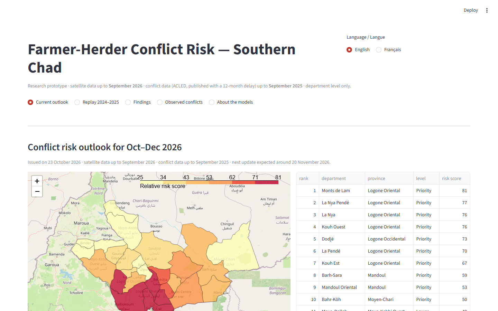

# Farmer-Herder Conflict Risk in Southern Chad

**Capstone project — BSc Software Engineering (Machine Learning), African Leadership University**

| | |
|---|---|
| 🎥 **Walkthrough video** | [VIDEO LINK — to be added](#) |
| 📄 **Technical report (PDF)** | [docs/technical_report.pdf](https://github.com/Sougnabe/chad-conflict-risk/blob/main/docs/technical_report.pdf) |
| 🌐 **Live dashboard** | [chad-conflict-risk.streamlit.app](https://chad-conflict-risk.streamlit.app/) |

## Overview

Violent clashes between farmers and herders killed about 470 people in the seven southern
provinces of Chad between 2019 and 2025, and the response usually comes after the violence.
This project estimates, **for each of the 26 southern departments and each quarter, the risk of
farmer-herder conflict**, so that humanitarian organisations, local authorities and mediation
committees can focus prevention before violence happens.

It combines:
- a **new dataset** of farmer-herder conflict events: all 1,593 ACLED events for Chad
  (2015–2025) classified with an AI assistant and a written codebook, validated by the author on a
  blind 60-event sample (Cohen's kappa = 0.83);
- **satellite indicators** from Google Earth Engine: crop greenness (MODIS NDVI), rainfall
  (CHIRPS), pasture conditions in the herds' northern departure zones, cropland, surface water,
  population;
- **machine-learning models** evaluated without look-ahead (selection on 2019–2023, single test
  on 2024 – Sept 2025);
- a **bilingual (English / French) dashboard** with the outlook for the coming quarter, the
  factors behind each department's score, a replay of 2024–2025 and the research findings.

**Research question.** Do satellite-derived indicators improve the prediction of farmer-herder
conflict risk, compared with conflict history alone?
**Main result.** With only the information really available at forecast time (conflict data
are published with a 12-month delay), conflict history alone scores at chance level (PR-AUC
0.110, chance = 0.110); adding satellite indicators raises it to 0.214. In the 2024–2025 replay,
the 10 departments flagged as priority had a conflict in 20% of quarters, against 5% for the
others. Details and limitations: `docs/model_card.md`.



## Technical requirements

| Item | Version / requirement |
|---|---|
| Language | Python 3.11 or later (developed and tested with **Python 3.13.2**) |
| Operating systems tested | Windows 11 (development); the dashboard is tested in Chromium, Firefox and WebKit |
| Main libraries | pandas 2.3, NumPy 2.3, GeoPandas 1.2, Shapely 2.1, scikit-learn 1.9, XGBoost 3.4, SHAP 0.53, joblib 1.5, Matplotlib 3.11 |
| Dashboard | Streamlit 1.64, Folium 0.20, streamlit-folium 0.27 |
| Data services | ACLED API (research account), Google Earth Engine (`earthengine-api` 1.7, non-commercial project) |
| Testing | pytest 9.1, Playwright 1.64 (browser tests), psutil 7.2 (benchmark) |
| Hardware | Any laptop with 4 GB RAM; peak memory ≈ 250 MB. Full training of the four configurations, with figures and reports, takes about 2.5–4 minutes on a 4-core laptop CPU |
| Storage | ≈ 10 MB for code and processed data (raw ACLED data are not distributed) |

Exact versions: `requirements.txt` (pipeline and dashboard), `requirements-dev.txt` (tests and
tools), `app/requirements.txt` (deployed dashboard only).

## Installation

```bash
git clone https://github.com/Sougnabe/chad-conflict-risk.git
cd chad-conflict-risk
python -m venv .venv
.venv\Scripts\activate            # Windows   (macOS/Linux: source .venv/bin/activate)
pip install -r requirements-dev.txt
python -m playwright install chromium firefox webkit   # only for the browser tests
```

**Run the dashboard** (uses the database included in the repository):

```bash
streamlit run app/app.py
```

**Run the tests:**

```bash
python -m pytest                   # 81 tests: unit + integration + dashboard
```

**Re-run the pipeline** (needs credentials; copy `.env.example` to `.env` and fill it in):

| Step | Command | Output |
|---|---|---|
| 1. Download conflict events | `python scripts/download_acled.py` | `data/raw/acled_chad_2015_2025.csv` |
| 2. Labels and target | `python scripts/build_target.py` | `data/processed/acled_chad_labeled.csv` |
| 3. Exploratory figures | `python scripts/eda_acled.py` | `reports/figures/` |
| 4. Department × month panel | `python scripts/build_panel.py` | `data/processed/panel_dept_month.csv` |
| 5. Dashboard database | `python scripts/init_db.py` | `data/app.db` |
| 6. Satellite indicators | `python scripts/gee_extract.py` (once: `earthengine authenticate`) | `data/processed/satellite_features.csv` |
| 7. Features (no look-ahead) | `python scripts/build_features.py` | `data/processed/features.csv` |
| 8. Training and evaluation | `python scripts/train_models.py --mode research --unit quarter` (also `--unit month`; `--mode operational --unit quarter --fixed-model logreg_OB`; `--mode operational --unit month`) | `reports/`, predictions in `data/app.db` |

**Monthly update of the outlook** (new satellite month → features → operational models):
`python scripts/update_outlook.py`. ACLED data are refreshed separately because new events must
first be classified with the codebook.

The whole pipeline, with its outputs and the package source code, is also available as a
notebook: `notebooks/capstone_pipeline.ipynb`.

## Repository structure

```
chad-conflict-risk/
├── chadrisk/                  # Python package (all the logic, object-oriented)
│   ├── config.py              # paths and constants, defined once
│   ├── data/                  # AcledClient, LabelledEvents, Geography, PanelBuilder, SatelliteExtractor
│   ├── features/              # FeatureGroup (abstract) + history, seasonal, satellite groups; builder
│   ├── models/                # RiskModel (abstract) + logistic, XGBoost, baseline rule
│   ├── evaluation/            # Evaluator, MonthBlockBootstrap, RollingOriginSelector, PriorityTiers
│   ├── experiment.py          # Experiment: one training/evaluation run
│   ├── reporting.py           # ExperimentReporter: result files, figures, predictions
│   └── storage.py             # RiskRepository: the only access to the SQLite database
├── app/                       # Streamlit dashboard
│   ├── app.py                 # page: one function per view
│   ├── components.py          # map and ranking components
│   └── i18n.py                # Translator + English/French texts
├── scripts/                   # thin command-line entry points (steps 1-8, update, benchmark, browsers)
├── tests/
│   ├── unit/                  # 56 tests of each class on synthetic data, ethics guards
│   └── integration/           # 25 tests of the real pipeline outputs and the dashboard
├── data/
│   ├── external/              # administrative boundaries (geoBoundaries)
│   ├── processed/             # labels, panel, satellite indicators, features
│   └── app.db                 # dashboard database (aggregated data only)
├── reports/                   # metrics, figures, performance and browser results
├── notebooks/                 # full pipeline notebook (generated by scripts/make_notebook.py)
└── docs/                      # codebook, model card, practitioner questionnaire, screenshots
```

## Architecture and design

- **Layered architecture:** data access (`data/`, `storage.py`) → feature engineering
  (`features/`) → models (`models/`) → evaluation (`evaluation/`) → orchestration
  (`experiment.py`, `reporting.py`) → presentation (`app/`). Scripts only parse arguments and
  call the package.
- **Abstraction and polymorphism:** `RiskModel` defines `fit`, `predict_risk`, `candidates` and
  `clone`; logistic regression, XGBoost and the baseline rule implement it, and selection,
  evaluation and prediction use any of them unchanged. `FeatureGroup` does the same for feature
  groups (`ConflictHistoryFeatures` is reused with a 1-month and a 13-month delay).
- **Encapsulation:** `RiskRepository` hides SQL; `AcledClient` hides authentication;
  `Translator` hides language handling.
- **Algorithms:** rolling-origin (expanding window) model selection run in parallel;
  month-block bootstrap confidence intervals; R-tree spatial index for the department
  neighbourhood graph; spatial join of events; vectorised O(n) "months since last conflict";
  leakage guard; priority tiers.

## Testing, performance and compatibility

| Evidence | File |
|---|---|
| 81 automated tests (unit, integration, functional dashboard tests with different inputs) | `tests/` |
| Benchmark: time and memory per stage, before/after optimisation | `reports/performance/benchmark.md`, `before_after.md` |
| Browser and device tests: Chromium, Firefox, WebKit; desktop, mobile, low-end emulation | `reports/performance/browsers.md`, `screenshots/` |

## Deployment

On Streamlit Community Cloud: main file `app/app.py` (dependencies from `app/requirements.txt`).
The deployed app reads only `data/app.db` and `reports/`, which hold aggregated data. The
database path can be changed with the environment variable `CHADRISK_DB`.

## Ethics

- **Approval.** ALU Research Ethics Committee, approval code **SEPT26-BSE-087**
  (5 November 2026, valid 6 months). Conditions: informed consent, information on purpose and
  data use, anonymity and confidentiality, no coercion or payment, any change of procedure
  reported to the REC within 48 hours.
- **Who is involved, and status.** The model uses only secondary data (ACLED events, public
  satellite data) and no information about identifiable people. The only research with people is
  an anonymous practitioner questionnaire (`docs/practitioner_feedback_form.md`). **It has not been
  sent yet: no participant data have been collected and no user testing with participants has
  taken place.** A prototype of the dashboard was public from October 2026, before the approval;
  it collected nothing from visitors and was not shown to any participant.
- **Consent.** The first section of the questionnaire explains purpose, anonymity, voluntary
  participation, withdrawal, data use and storage, with researcher and REC contacts; a required
  "I agree" question must be accepted before the other questions. No name, email, organisation or
  location is recorded; answers are deleted at the end of the project.
- **Protected characteristics.** No ethnic, religious, language or actor variable is used:
  `check_feature_sets` (`chadrisk/experiment.py`) stops training if a feature describes one of
  them (8 unit tests in `tests/unit/test_ethics.py`). Outputs are aggregated for the 26
  departments: no villages, names or event descriptions.
- **Honest scores.** Departments are shown in two priority levels with their measured meaning
  (Priority: conflict in 20% of quarters in 2024–2025; Lower: 5%), never as exact probabilities;
  a permanent warning says scores support, not replace, local judgement.
- **No tracking.** The dashboard collects nothing about its visitors (no forms, no analytics;
  Streamlit usage statistics are disabled in `.streamlit/config.toml`). Credentials stay in
  `.env`, which is excluded from git.
- **Privacy & Terms page** (in the app): transparency notice, single declared purpose (prevention
  planning, decision support only), prohibited uses (targeting, profiling or policing communities,
  automated decisions, "danger maps"…) and data licences. Every map cites ACLED.
- **Frameworks.** Designed against Chad's Law n° 007/PR/2015 on personal data protection (binding
  in Chad), Rwanda's Law n° 058/2021 (binding where ALU is based and where the questionnaire
  answers are processed), the African Union Malabo Convention (binding on Rwanda; guidance for
  Chad, which signed but has not ratified), the UNESCO Recommendation on the Ethics of AI and the
  ACM Code of Ethics (guidance).
- **Known limitations.** The guard checks feature names, not hidden proxies; ACLED reporting bias
  cannot be corrected without field data; practitioner validation is still to come; no Arabic
  version; the map takes about 33 s to load on a low-end phone with slow 3G; herder and farmer
  communities have not been consulted directly. See `docs/model_card.md`.

## AI use

The problem, the model concept (northern herds moving south in the dry season and reaching
farmers' fields at planting and harvest) and all decisions are the author's. The author wrote the
code (the `chadrisk` package, the dashboard and the tests) and used an AI assistant to clean it up
(bug fixes, structure, additional tests). The labelling codebook and the classification of the
1,593 ACLED events were produced by an AI assistant following the author's instructions; the
author labelled a stratified sample of 60 events blind (Cohen's kappa = 0.83, farmer-herder vs.
other) and added two codebook rules from the disagreements. The dashboard texts were drafted with
an AI assistant and edited by the author.

## Copyright and licences

© 2026 Sougnabe Payang. **All rights reserved.** The repository is public so that it can be
viewed under GitHub's terms, but it has no open-source licence: the code, codebook, labels and
dashboard texts may not be reused without permission.

Third-party components remain the property of their authors and are used under their licences:

| Component | Licence | Use |
|---|---|---|
| pandas, NumPy, GeoPandas, Shapely, scikit-learn, joblib, python-dotenv, psutil, nbformat, nbconvert | BSD-3-Clause | unmodified dependencies (`requirements*.txt`) |
| XGBoost, Streamlit, earthengine-api, requests, Playwright | Apache-2.0 | unmodified dependencies |
| SHAP, folium, streamlit-folium, pytest | MIT | unmodified dependencies |
| Matplotlib | Matplotlib License (PSF-based) | unmodified dependency |
| Leaflet (map engine, via folium) | BSD-2-Clause | attribution on every map |
| Google Earth Engine (service) | Google Earth Engine Terms of Service | non-commercial research account |
| ACLED conflict events | ACLED End User License Agreement and Attribution Policy | non-commercial; raw data not redistributed (`.gitignore`), only department-level counts published; cited under every map |
| MODIS MOD13Q1 v061 (NASA LP DAAC) | NASA data policy, no restrictions | cited |
| CHIRPS rainfall (Climate Hazards Center, UCSB) | public domain | cited |
| ESA WorldCover 2021 v200 | CC BY 4.0 | attribution on the Privacy page |
| JRC Global Surface Water v1.4 | Copernicus data policy, acknowledgement required | cited |
| WorldPop 100 m population 2020 | CC BY 4.0 | attribution on the Privacy page |
| geoBoundaries / OCHA Chad boundaries | CC BY 3.0 IGO | attribution under every map |
| OpenStreetMap background tiles | ODbL 1.0; OSMF Tile Usage Policy | "© OpenStreetMap contributors" on the map |
