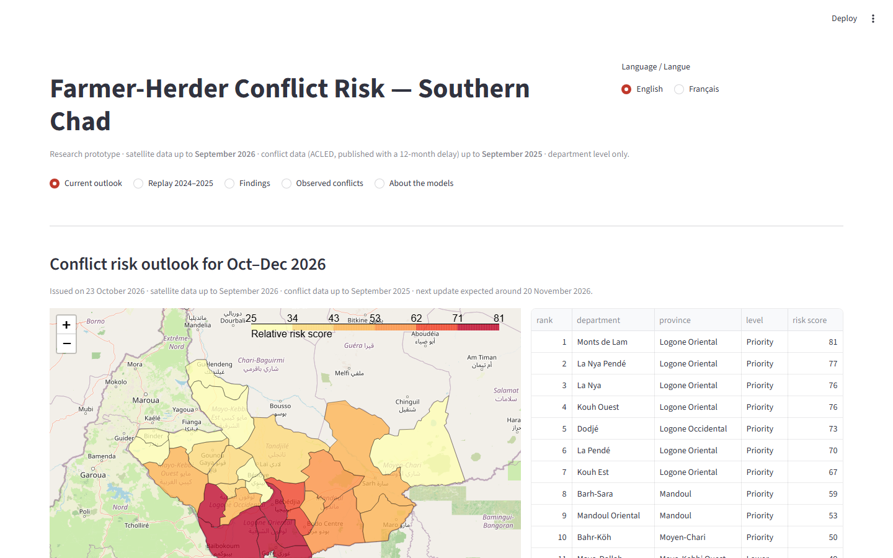

# Farmer-Herder Conflict Risk in Southern Chad

**Capstone project — BSc Software Engineering (Machine Learning), African Leadership University**

| | |
|---|---|
| 🎥 **Walkthrough video** | [VIDEO LINK — to be added](#) |
| 📄 **Technical report (PDF)** | [REPORT LINK — to be added](#) |
| 🌐 **Live dashboard** | [DASHBOARD LINK — to be added](#) |

## Overview

Violent clashes between farmers and herders killed about 470 people in the seven southern
provinces of Chad between 2019 and 2025, and the response usually comes after the violence.
This project estimates, **for each of the 26 southern departments and each quarter, the risk of
farmer-herder conflict**, so that humanitarian organisations, local authorities and mediation
committees can focus prevention before violence happens.

It combines:
- a **new, validated dataset** of farmer-herder conflict events: all 1,593 ACLED events for Chad
  (2015–2025) classified with a written codebook, blind validation Cohen's kappa = 0.83;
- **satellite indicators** from Google Earth Engine: crop greenness (MODIS NDVI), rainfall
  (CHIRPS), pasture conditions in the herds' northern departure zones, cropland, surface water,
  population;
- **machine-learning models** evaluated without look-ahead (selection on 2019–2023, single test
  on 2024 – Sept 2025);
- a **bilingual (English / French) dashboard** with the outlook for the coming quarter, the
  factors behind each department's score, a replay of 2024–2025 and the research findings.

**Research question.** Do satellite-derived indicators improve the prediction of farmer-herder
conflict risk, compared with conflict history alone?
**Main result.** With only the information really available at forecast time (conflict data
are published with a 12-month delay), conflict history alone scores at chance level (PR-AUC
0.110, chance = 0.110); adding satellite indicators raises it to 0.214. In the 2024–2025 replay,
the 10 departments flagged as priority had a conflict in 20% of quarters, against 5% for the
others. Details and limitations: `docs/model_card.md`.



## Technical requirements

| Item | Version / requirement |
|---|---|
| Language | Python 3.11 or later (developed and tested with **Python 3.13.2**) |
| Operating systems tested | Windows 11 (development); the dashboard is tested in Chromium, Firefox and WebKit |
| Main libraries | pandas 2.3, NumPy 2.3, GeoPandas 1.2, Shapely 2.1, scikit-learn 1.9, XGBoost 3.4, SHAP 0.53, joblib 1.5, Matplotlib 3.11 |
| Dashboard | Streamlit 1.64, Folium 0.20, streamlit-folium 0.27 |
| Data services | ACLED API (research account), Google Earth Engine (`earthengine-api` 1.7, non-commercial project) |
| Testing | pytest 9.1, Playwright 1.64 (browser tests), psutil 7.2 (benchmark) |
| Hardware | Any laptop with 4 GB RAM; peak memory ≈ 250 MB. Full training of the four configurations, with figures and reports, takes about 2.5–4 minutes on a 4-core laptop CPU |
| Storage | ≈ 10 MB for code and processed data (raw ACLED data are not distributed) |

Exact versions: `requirements.txt` (pipeline and dashboard), `requirements-dev.txt` (tests and
tools), `app/requirements.txt` (deployed dashboard only).

## Installation

```bash
git clone https://github.com/Sougnabe/chad-conflict-risk.git
cd chad-conflict-risk
python -m venv .venv
.venv\Scripts\activate            # Windows   (macOS/Linux: source .venv/bin/activate)
pip install -r requirements-dev.txt
python -m playwright install chromium firefox webkit   # only for the browser tests
```

**Run the dashboard** (uses the database included in the repository):

```bash
streamlit run app/app.py
```

**Run the tests:**

```bash
python -m pytest                   # 70 tests: unit + integration + dashboard
```

**Re-run the pipeline** (needs credentials; copy `.env.example` to `.env` and fill it in):

| Step | Command | Output |
|---|---|---|
| 1. Download conflict events | `python scripts/download_acled.py` | `data/raw/acled_chad_2015_2025.csv` |
| 2. Labels and target | `python scripts/build_target.py` | `data/processed/acled_chad_labeled.csv` |
| 3. Exploratory figures | `python scripts/eda_acled.py` | `reports/figures/` |
| 4. Department × month panel | `python scripts/build_panel.py` | `data/processed/panel_dept_month.csv` |
| 5. Dashboard database | `python scripts/init_db.py` | `data/app.db` |
| 6. Satellite indicators | `python scripts/gee_extract.py` (once: `earthengine authenticate`) | `data/processed/satellite_features.csv` |
| 7. Features (no look-ahead) | `python scripts/build_features.py` | `data/processed/features.csv` |
| 8. Training and evaluation | `python scripts/train_models.py --mode research --unit quarter` (also `--unit month`; `--mode operational --unit quarter --fixed-model logreg_OB`; `--mode operational --unit month`) | `reports/`, predictions in `data/app.db` |

**Monthly update of the outlook** (new satellite month → features → operational models):
`python scripts/update_outlook.py`. ACLED data are refreshed separately because new events must
first be classified with the codebook.

The whole pipeline, with its outputs and the package source code, is also available as a
notebook: `notebooks/capstone_pipeline.ipynb`.

## Repository structure

```
chad-conflict-risk/
├── chadrisk/                  # Python package (all the logic, object-oriented)
│   ├── config.py              # paths and constants, defined once
│   ├── data/                  # AcledClient, LabelledEvents, Geography, PanelBuilder, SatelliteExtractor
│   ├── features/              # FeatureGroup (abstract) + history, seasonal, satellite groups; builder
│   ├── models/                # RiskModel (abstract) + logistic, XGBoost, baseline rule
│   ├── evaluation/            # Evaluator, MonthBlockBootstrap, RollingOriginSelector, PriorityTiers
│   ├── experiment.py          # Experiment: one training/evaluation run
│   ├── reporting.py           # ExperimentReporter: result files, figures, predictions
│   └── storage.py             # RiskRepository: the only access to the SQLite database
├── app/                       # Streamlit dashboard
│   ├── app.py                 # page: one function per view
│   ├── components.py          # map and ranking components
│   └── i18n.py                # Translator + English/French texts
├── scripts/                   # thin command-line entry points (steps 1-8, update, benchmark, browsers)
├── tests/
│   ├── unit/                  # 48 tests of each class on synthetic data
│   └── integration/           # 22 tests of the real pipeline outputs and the dashboard
├── data/
│   ├── external/              # administrative boundaries (geoBoundaries)
│   ├── processed/             # labels, panel, satellite indicators, features
│   └── app.db                 # dashboard database (aggregated data only)
├── reports/                   # metrics, figures, performance and browser results
├── notebooks/                 # full pipeline notebook (generated by scripts/make_notebook.py)
└── docs/                      # codebook, model card, practitioner questionnaire, screenshots
```

## Architecture and design

- **Layered architecture:** data access (`data/`, `storage.py`) → feature engineering
  (`features/`) → models (`models/`) → evaluation (`evaluation/`) → orchestration
  (`experiment.py`, `reporting.py`) → presentation (`app/`). Scripts only parse arguments and
  call the package.
- **Abstraction and polymorphism:** `RiskModel` defines `fit`, `predict_risk`, `candidates` and
  `clone`; logistic regression, XGBoost and the baseline rule implement it, and selection,
  evaluation and prediction use any of them unchanged. `FeatureGroup` does the same for feature
  groups (`ConflictHistoryFeatures` is reused with a 1-month and a 13-month delay).
- **Encapsulation:** `RiskRepository` hides SQL; `AcledClient` hides authentication;
  `Translator` hides language handling.
- **Algorithms:** rolling-origin (expanding window) model selection run in parallel;
  month-block bootstrap confidence intervals; R-tree spatial index for the department
  neighbourhood graph; spatial join of events; vectorised O(n) "months since last conflict";
  leakage guard; priority tiers.

## Testing, performance and compatibility

| Evidence | File |
|---|---|
| 70 automated tests (unit, integration, functional dashboard tests with different inputs) | `tests/` |
| Benchmark: time and memory per stage, before/after optimisation | `reports/performance/benchmark.md`, `before_after.md` |
| Browser and device tests: Chromium, Firefox, WebKit; desktop, mobile, low-end emulation | `reports/performance/browsers.md`, `screenshots/` |

## Deployment

On Streamlit Community Cloud: main file `app/app.py` (dependencies from `app/requirements.txt`).
The deployed app reads only `data/app.db` and `reports/`, which hold aggregated data. The
database path can be changed with the environment variable `CHADRISK_DB`.

## Data and ethics

- Raw ACLED data and any file containing event notes are not redistributed (licence); they are
  excluded by `.gitignore`.
- Outputs are aggregated at department level; no ethnic or religious variable is used.
- The dashboard supports human decisions; it does not make them. Intended and prohibited uses:
  `docs/model_card.md`.
- AI tools were used for coding assistance and for a first-pass event classification; every
  label used as ground truth was checked against a blind human validation.
